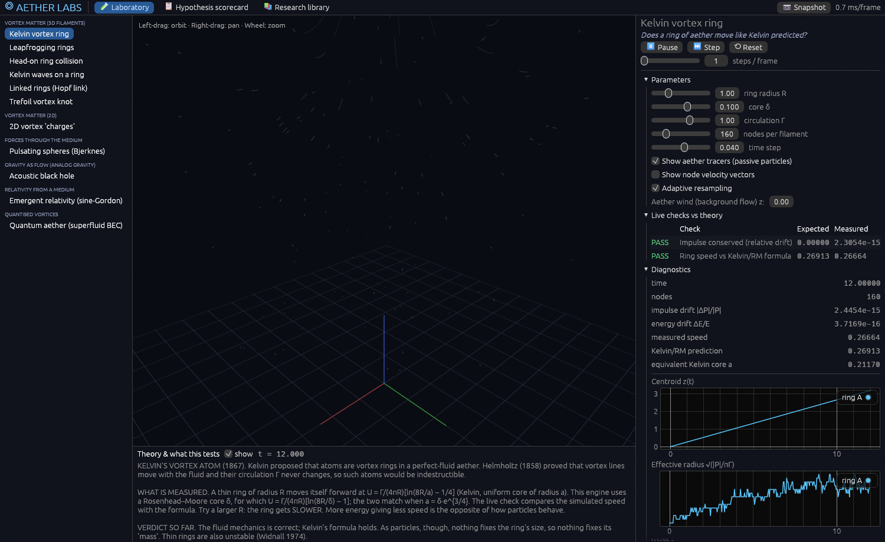
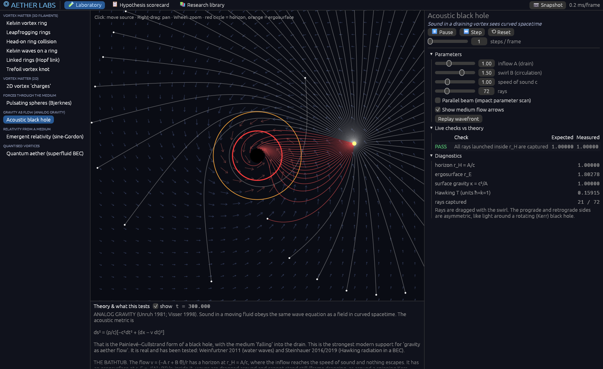
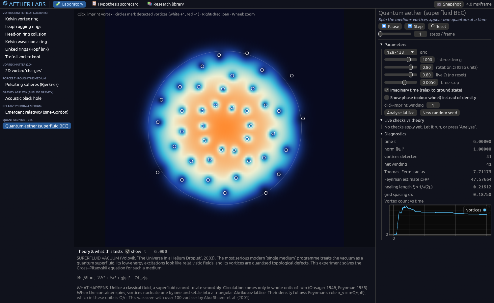
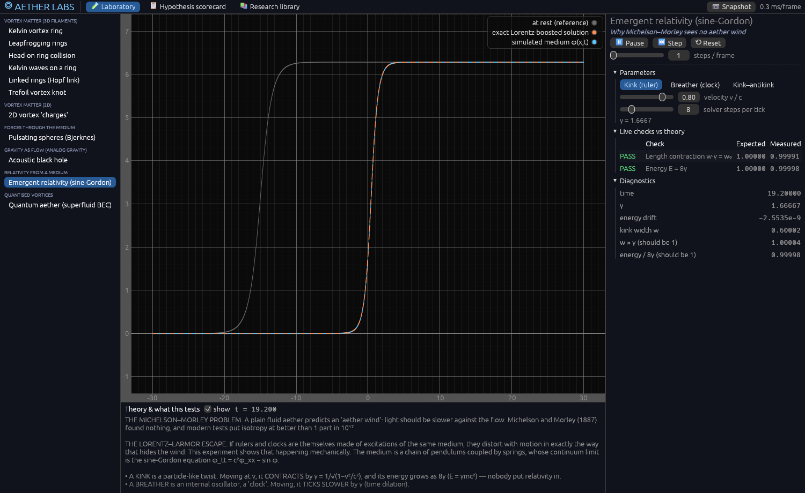
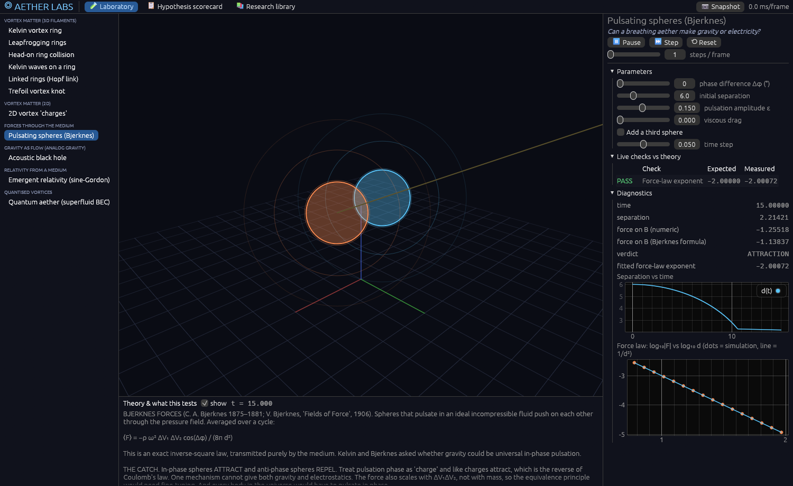
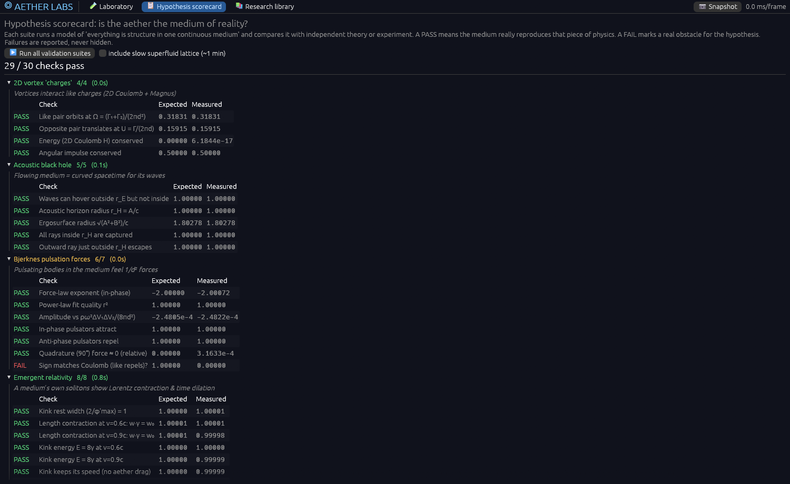

# ◎ Aether Labs

**A desktop physics laboratory for testing one idea: that reality is a single continuous medium (an *aether*), and that matter and forces are vortices and flows within it.**

Aether Labs runs real numerical models of a vortex/fluid aether and checks each one **quantitatively** against independent theory and experiment. Every experiment reports **PASS** or **FAIL**. Where the aether picture works, you see it work. Where it historically broke down, you see that too, with the numbers.

Native Rust: [`egui`](https://github.com/emilk/egui) for the interface, `rayon` for multi-core physics, double precision throughout.



---

## Why this exists

The vortex aether was serious science:
- **Helmholtz (1858)** proved vortex lines are frozen into an ideal fluid.
- **Kelvin (1867)** proposed that atoms are knotted vortex rings.
- **Maxwell (1861)** derived displacement current and the speed of light from a model of molecular vortices.
- **Bjerknes (1870s–1906)** showed that pulsating spheres in a fluid feel inverse-square forces.

It was abandoned for concrete, measurable reasons. Modern physics has revived parts of the idea in rigorous form:
- **Analog gravity:** Unruh 1981; Visser 1998.
- **Superfluid vacuum:** Volovik.
- **Emergent Lorentz invariance** in media.

Aether Labs puts all of this in one place and lets you test it.

## Experiments

| Area | Experiment | What it tests | Key check |
|---|---|---|---|
| **Vortex matter (3D)** | Kelvin vortex ring | Kelvin's vortex atom | Ring speed = Γ/(4πR)[ln(8R/δ) − 1], within 1% |
| | Leapfrogging rings | Two "atoms" interacting through the medium | Impulse and energy conserved |
| | Head-on collision | Opposite rings spread apart | Impulse conservation |
| | Kelvin waves | Vibrations of a vortex atom (Kelvin's "spectral lines") | Writhe, Widnall instability |
| | Hopf link | Topology frozen into an ideal medium | Linking number stays 1 |
| | Trefoil knot | Kelvin/Tait knotted atoms; Kleckner & Irvine 2013 | Knot type preserved without reconnection |
| **Vortex matter (2D)** | Vortex "charges" | 2D Coulomb energy with Magnus-type motion | Ω = (Γ₁+Γ₂)/(2πd²), U = Γ/(2πd) |
| **Forces** | Pulsating spheres (Bjerknes) | Can a "breathing" aether make gravity or electricity? | F ∝ 1/d², exponent −2.000; **sign inverted vs Coulomb** |
| **Gravity as flow** | Acoustic black hole | Sound in a draining vortex sees a curved spacetime | Horizon r = A/c, ergosurface √(A²+B²)/c |
| **Relativity** | Emergent relativity (sine-Gordon) | Why Michelson–Morley sees no aether wind | Length contraction, E = 8γ, time dilation by γ |
| **Quantum aether** | Rotating superfluid (Gross–Pitaevskii) | Quantised vortices in a superfluid vacuum | Feynman rule n = Ω/π, triangular lattice, coarse-grained v = Ωr |
| **Scale hierarchy** | Vortex of vortices | A vortex made of ever-smaller vortices "until it becomes nothing": does it become one classical vortex? | N → ∞ bundle → hollow Kelvin ring (0.7%); far field sees only impulse (10⁻⁵) |

Every experiment has:
- live parameter controls
- a 3D or 2D view (orbit, pan, zoom, click to interact)
- live diagnostic plots
- **live checks against theory**
- a theory panel explaining what aether theory claims, what mainstream physics says, and what the experiment measures

Passive **"aether tracers"** show the medium itself flowing around the vortices.

<table>
<tr>
<td><br/><b>Acoustic black hole.</b> Sound rays are dragged and captured by a flowing medium. Red marks the horizon, orange the ergosurface.</td>
<td><br/><b>Quantum aether.</b> Spinning a superfluid makes vortices appear one quantum at a time and settle into a lattice.</td>
</tr>
<tr>
<td><br/><b>Emergent relativity.</b> A particle made of the medium contracts by exactly γ, with no relativity put in by hand.</td>
<td><br/><b>Bjerknes forces.</b> Pulsating spheres attract with an exact 1/d² law, but with the wrong sign for electricity.</td>
</tr>
</table>

## The Hypothesis Scorecard

One click runs every validation suite on background threads. The results are set against a **12-point checklist of what any single-medium theory must reproduce**, drawn from the research brief: light-speed isotropy, a universal limiting speed, inverse-square laws, correct force signs, charge quantisation, stable particles, spin-½, the equivalence principle, E² = p²c² + m²c⁴, no drag, and Einstein gravity.



### Current verdict (v0.1)

| ✅ What a single medium reproduces | ❌ Where it fails |
|---|---|
| Kelvin's ring dynamics, conserved impulse and energy | **Force sign**: Bjerknes "like charges" *attract* |
| Topological charge (linking number, quantised circulation) | **Stable particles**: rings have no fixed size; knots untie by reconnection |
| Exact inverse-square forces through the medium | **Equivalence principle**: Bjerknes force ∝ ΔV₁ΔV₂, not mass |
| Horizons, ergoregions, frame dragging, Hawking temperature | **Spin-½**: needs field solitons, not fluid vortices |
| Lorentz contraction, E = γmc², time dilation | **Einstein gravity**: the acoustic metric is kinematic, not sourced by mass |

## Research library

The app includes the full research behind it, searchable in-app and readable here:

- [`docs/RESEARCH-physics.md`](docs/RESEARCH-physics.md): history and physics of the vortex aether, its modern descendants, the 12-point checklist, a ranked list of experiments, and references.
- [`docs/RESEARCH-hierarchy.md`](docs/RESEARCH-hierarchy.md): vortices made of vortices, coarse-graining from quantum to classical, emergent-gravity programmes (Sakharov, Jacobson, Verlinde, Volovik) and the no-go theorems, with an experiment programme and results.
- [`docs/RESEARCH-methods.md`](docs/RESEARCH-methods.md): numerical methods (Biot–Savart filaments, vortons, grid fluids, lattice Boltzmann, Gross–Pitaevskii), validation targets and performance.
- [`docs/ROADMAP.md`](docs/ROADMAP.md): what's done and what's next.

## Getting started

### Requirements
- [Rust](https://rustup.rs) (stable, 2024 edition).
- **Windows with the GNU toolchain:** MinGW on `PATH`, for `dlltool`. For example, `winget install BrechtSanders.WinLibs.POSIX.UCRT`. The MSVC toolchain works without this.

### Run

```bash
cargo run --release -p aether-lab
```

### Controls

| Action | Input |
|---|---|
| Pause / run | `Space` or the ⏸ button |
| Orbit (3D) | Left-drag |
| Pan | Right-drag |
| Zoom | Mouse wheel |
| Add vortex / move source / imprint vortex (2D) | Left-click |
| Save PNG of the window | 📷 Snapshot |

### Command line

```bash
aether-lab --experiment 8                                   # open a specific experiment (0–11)
aether-lab --page scorecard                                 # open the scorecard and run all suites
aether-lab --experiment 0 --frames 300 --screenshot ring.png  # render, save a PNG, exit
```

### Tests

Every physics model has validation tests that run with `cargo test`:

```bash
cargo test --release -p aether-core              # fast suite (~1 s)
cargo test --release -p aether-core -- --ignored # slow superfluid-lattice test (~1 min)
```

## Project layout

```
crates/
  aether-core/   Pure physics library: no GUI, f64 + rayon, every model has checks()
    filament.rs    Rosenhead–Moore Biot–Savart vortex filaments, RK4, resampling, impulse/energy/linking/writhe
    pointvortex.rs 2D point vortices
    bjerknes.rs    Pulsating spheres in an ideal medium
    acoustic.rs    Acoustic metric ray tracing (draining bathtub)
    sinegordon.rs  Sine-Gordon medium: kinks, breathers, emergent Lorentz symmetry
    gpe.rs         2D rotating Gross–Pitaevskii superfluid (split-step FFT), coarse-grained rotation curve
    hierarchy.rs   Vortex-of-vortices bundles, N → ∞ limit, far-field universality, vortex clusters
  aether-lab/    egui desktop app: experiments, views, scorecard, library
docs/            Research briefs, roadmap, screenshots
```

## Roadmap

Next up:
- vortex reconnection (knots that untie, as in real fluids)
- a compressible lattice-Boltzmann medium (Bjerknes forces with retardation)
- a two-species universality-of-*c* test
- Kelvin-wave dispersion
- 3D superfluid rings
- Hopfion solitons
- GPU acceleration
- packaged releases

See [`docs/ROADMAP.md`](docs/ROADMAP.md).

## License

MIT
